<div dir="rtl">

# Rubinny

**שילוט דיגיטלי חינמי בקוד פתוח, שנראה כאילו מעצב גרפי עבד עליו.** תפריטים, הקרנות, מבצעים, מסכי קבלת פנים ולוחות מודעות למסעדות, בתי קפה, בתי קולנוע, חנויות, משרדים, מלונות ומרכזים קהילתיים: מוכנים בלחיצה, נערכים בלוח ניהול באינטרנט ומוצגים בכמה מסכים שרוצים. אירוח עצמי, נגן שממשיך לעבוד גם בלי אינטרנט, ותמיכה מובנית בעברית, RTL ונגישות.
רץ על כל מכשיר עם דפדפן מודרני: Raspberry Pi, Windows, Linux, Android, Android TV ו-Fire TV, ומסכי Samsung ‏(Tizen) ו-LG ‏(webOS) (עדיין לא נבדק על מכשיר).

[English](README.md) · [אפיון ו-Roadmap](docs/PLAN.md) · [תרומה לפרויקט](CONTRIBUTING.md) · [אבטחה](SECURITY.md) · [חסות](#תמיכה-בפרויקט)

> **סטטוס: בפיתוח פעיל (v0.7).** כל תשעת השלבים שתוכננו הושלמו, ויש גרסאות מאז 0.1. אפשר להתחיל לבחון ולהריץ פיילוט. לפני שימוש בפרודקשן עברו על [רשימת הבדיקות לפרודקשן](docs/PRODUCTION-CHECKLIST.md), שמפרטת גם מה עדיין צריך בדיקה מקצועית.

</div>

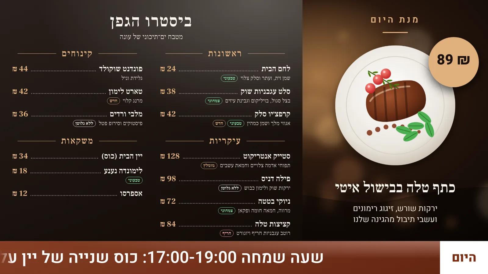

▶ **סרטון של 30 שניות:** [לרוחב](docs/video/rubinny-ad-he-16x9.mp4) · [לאורך](docs/video/rubinny-ad-he-9x16.mp4) (באנגלית: [לרוחב](docs/video/rubinny-ad-en-16x9.mp4) · [לאורך](docs/video/rubinny-ad-en-9x16.mp4))

<div dir="rtl">

## מוכן לעסק שלכם

בוחרים תחום ומקבלים מסך גמור בלחיצה אחת: שקפים מעוצבים, תפריט או לוח זמנים, טקסט רץ, ולפי הצורך גם שעון, ספירה לאחור או קוד QR.
כל ערכה מגיעה בעברית או באנגלית, וכל התמונות בה הן איורים מקוריים שצוירו במיוחד לפרויקט ([Rubinny Art Pack](LICENSING.md), ‏CC0).
משנים כל טקסט, מחיר או צבע בלוח הניהול.

</div>

|                                                      בית קולנוע                                                      |                                                       בית קפה                                                        |
| :------------------------------------------------------------------------------------------------------------------: | :------------------------------------------------------------------------------------------------------------------: |
| 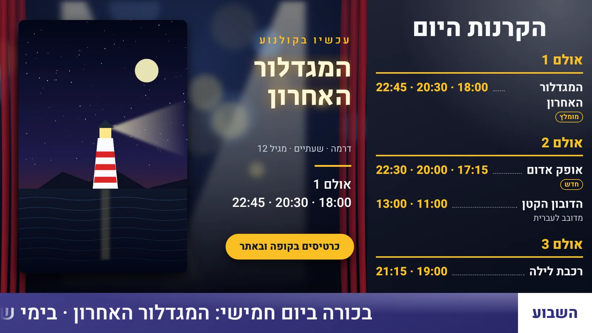 | 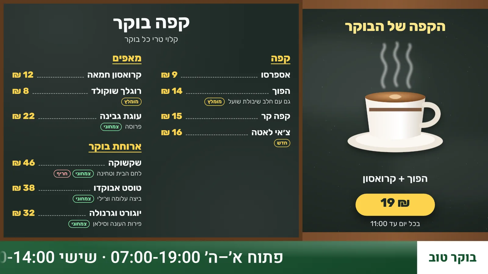 |
|                                                       **חנות**                                                       |                                                       **משרד**                                                       |
|        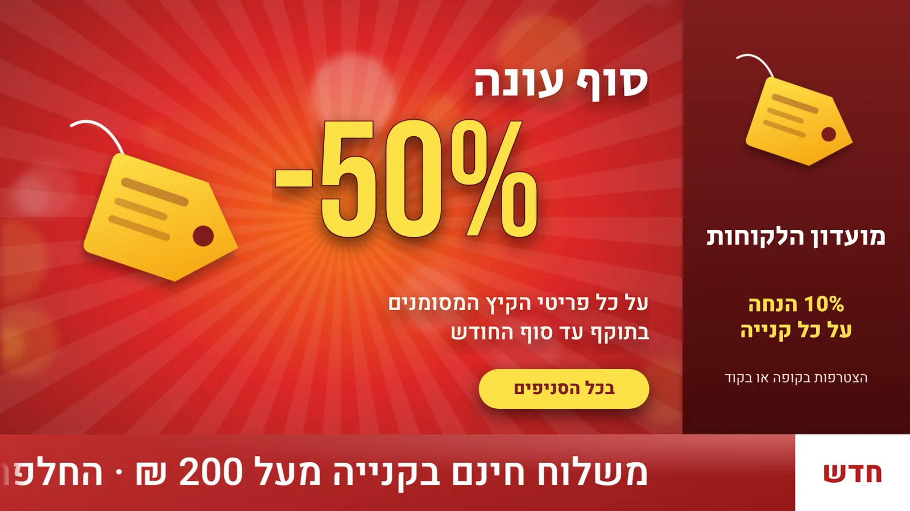        |     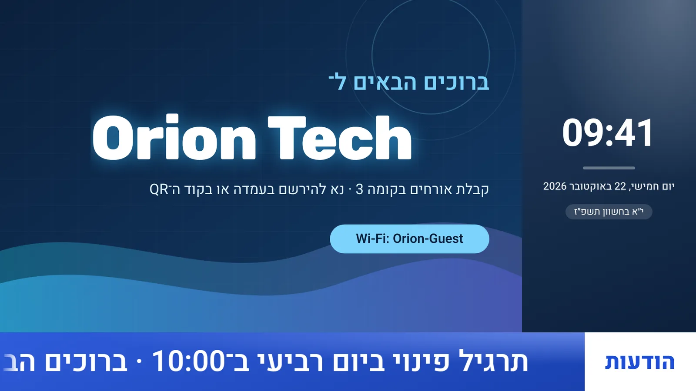      |
|                                                       **מלון**                                                       |                                                   **מרכז קהילתי**                                                    |
|      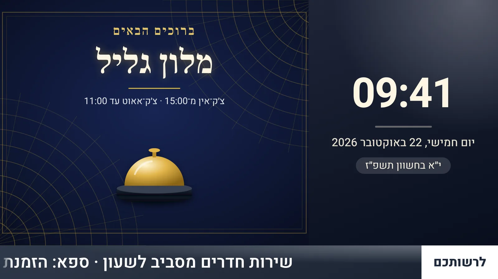      |     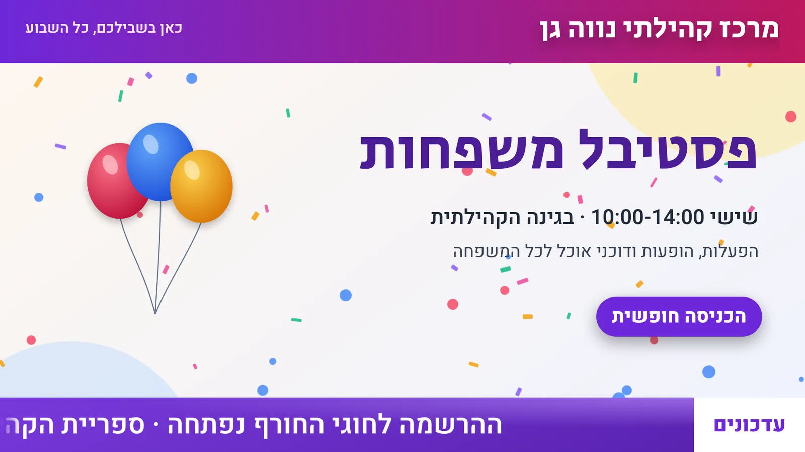      |

<details>
<summary>אותן ערכות באנגלית</summary>

|    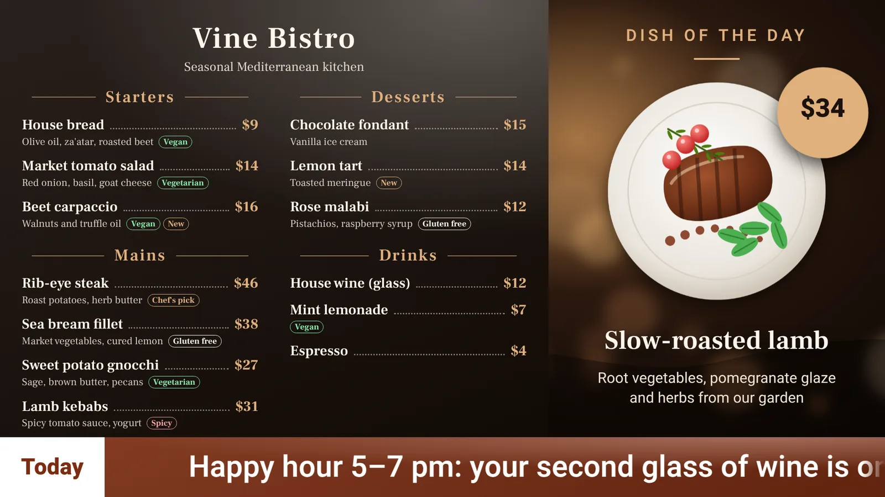    | 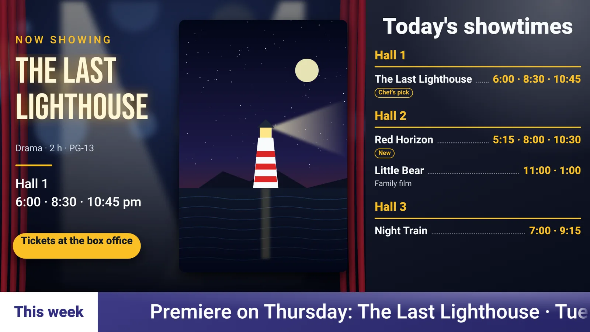 |
| :--------------------------------------------------------------------: | :---------------------------------------------------------------: |
|      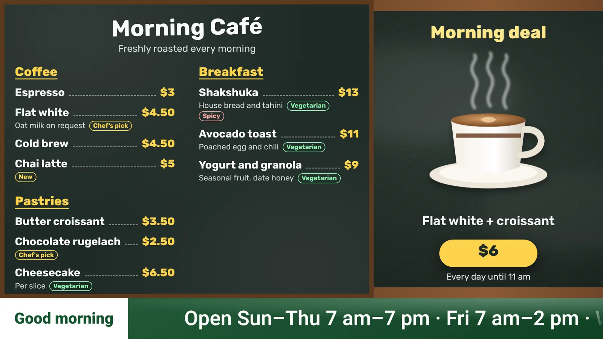      |        |
|      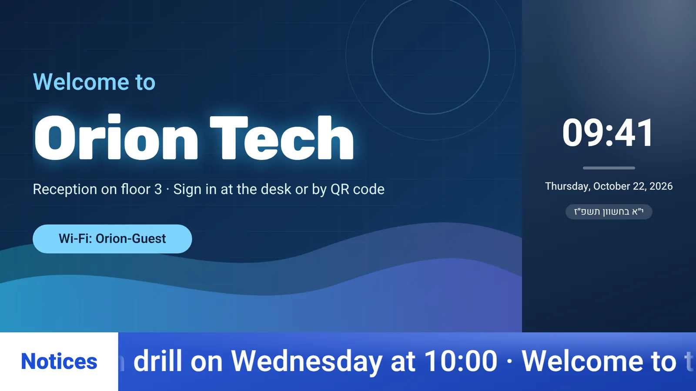       |    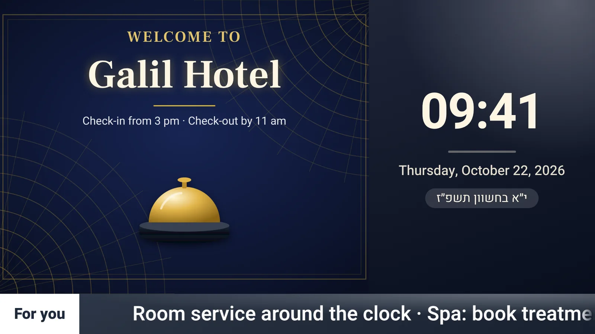     |
| 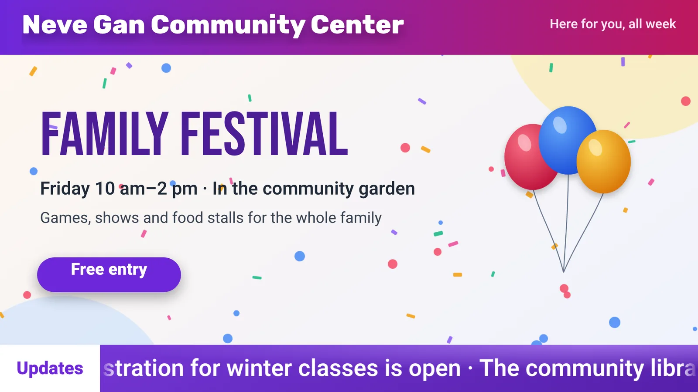 |                                                                   |

</details>

<div dir="rtl">

## מה יש ב-Rubinny

### במסכים

- **נגן Web שעובד גם בלי אינטרנט:**
  - מחברים מסך עם קוד של 6 תווים.
  - הנגן ממשיך לנגן מ-Cache מקומי מאומת, גם כשהרשת נופלת וגם אחרי הפעלה מחדש.
- **עדכונים חיים:** שינוי בלוח הניהול מגיע למסכים תוך שניות.
- **נגנים לכל מכשיר** ([הוראות התקנה](docs/players.he.md)):
  - **מה יש:** כל דפדפן, אפליקציית מחשב ל-Windows ול-Linux, סקריפט קיוסק ל-Raspberry Pi ואפליקציה ל-Android ול-Android TV.
  - **באפליקציות המחשב וה-Android:** עולות עם המכשיר, נשארות במסך מלא, חוזרות לבד אחרי קריסה, ושולחות **צילום מסך מרחוק אמיתי** ללוח הניהול.
- **תבניות עם אזורים:** כל אזור מנגן פלייליסט משלו, למשל וידאו, שעון וטקסט רץ במקביל.
- **Widgets מובנים:**
  - שעון עם תאריך עברי.
  - טקסט, וטקסט רץ שמתאים את עצמו לעברית.
  - קוד QR, חדשות (RSS) ומזג אוויר (לפי בחירה).
  - דף אינטרנט וספירה לאחור.
  - **תפריט ומחירון:** חלוקה לקטגוריות, מחירים בשקלים, דולרים, יורו או לירות שטרלינג, תגיות כמו טבעוני, חריף או חדש, עד 3 טורים, בסגנון מודרני, קלאסי או לוח גיר.
  - **התחברות דרך הארגון (SSO):** ‏Google Workspace, ‏Microsoft Entra ID, ‏Keycloak או כל ספק OIDC.
  - **אישור תוכן (רשות):** שינויים של עורכים עולים למסכים רק אחרי אישור מנהל.
  - **התראות חירום:** פינוי, מרחב מוגן או נעילה, מעל כל התוכן בכל המסכים או במסכים נבחרים, תוך שניות.
  - טבלת נתונים מ-Google Sheets, ‏CSV או JSON: תפריטים, מחירונים ולוחות זמנים שמתעדכנים לבד.
  - **עיצוב חופשי.**
- **התאמת תמונה לאזור:**
  - **התאמה:** כל התמונה מוצגת.
  - **מילוי:** התמונה ממלאת את האזור ונחתכת בשוליים.
  - **רקע מטושטש:** כל התמונה מוצגת, ומאחוריה עותק מטושטש במקום פסים שחורים.

</div>

|                            ערכת תפריט                             |                                  ספירה לאחור                                   |                         עיצוב חופשי                         |
| :---------------------------------------------------------------: | :----------------------------------------------------------------------------: | :---------------------------------------------------------: |
|  |  |  |

<div dir="rtl">

### בלוח הניהול

- **עורך עיצוב חופשי:**
  - גוררים, משנים גודל ומיישרים טקסט, תמונות וצורות על קנבס, עם הצמדה לקצוות ולמרכז.
  - ביטול ושחזור, שכבות ותבניות מוכנות.
  - מעברי צבע, צללים והילות, קו מתאר לטקסט, שכבת צבע מעל תמונות וחמישה גופנים עם עברית.
  - אנימציות כניסה ותנועה מתמשכת. במסכים שביקשו פחות תנועה הן לא מופעלות.
  - שליטה מלאה גם מהמקלדת.
- **מאגר תמונות חופשי:** מחפשים תמונות בנחלת הכלל (CC0) ומוסיפים בלחיצה. ההורדה עוברת דרך השרת ובאותה סריקה כמו כל העלאה.
- **תזמון:** מחליפים תבנית או פלייליסט לפי ימים, שעות ותאריכים: תפריט בוקר עד 11:00, מבצע לשבוע, תוכן מיוחד בשישי.
  - השורה העליונה גוברת, והתנאים נבדקים לפי השעון של כל מסך.
  - ציר זמן שבועי מראה מה יוצג, ומזהיר על שורות שלא יוצגו בכלל.
- **תפעול:**
  - עמוד לכל מסך: מה מוצג עכשיו בכל אזור, זמינות ב-24 שעות וב-7 ימים, ובדיקת שעון. הנגן מתקן לבד שעון שגוי לפי שעון השרת.
  - התראה במייל כשמסך מתנתק, והודעה כשהוא חוזר.
  - **דוחות הצגה (Proof-of-Play)** לפי תוכן וטווח תאריכים, כולל ייצוא ל-CSV.
- **ערכות מוכנות:** לחיצה אחת יוצרת מסך מעוצב, בעברית או באנגלית:
  - שבע לפי תחום: מסעדה, בית קפה, בית קולנוע, חנות, משרד, מלון ומרכז קהילתי.
  - שלוש כלליות: לובי, תפריט ולוח מודעות.
- **ספריית מדיה מאובטחת:** כל קובץ שעולה עובר הסגר, סריקת וירוסים (ClamAV), קידוד מחדש והסרת מטא-דאטה (EXIF/GPS) לפני שהוא זמין.
- **ארגונים ותפקידים:** בעלים, מנהל, עורך וצופה. יש גם הזמנות, אימות דו-שלבי ויומן פעולות.
- **עברית ונגישות מהיסוד:** RTL, מצב כהה, ניווט מלא במקלדת ותפריט התאמות נגישות. כל עמוד נבדק אוטומטית עם axe-core (יעד: WCAG 2.1 AA).

</div>


<details dir="rtl">
<summary>עוד צילומי מסך</summary>

| עורך התפריט והמחירון                                                                | ערכות מוכנות לפי תחום                                                              |
| ----------------------------------------------------------------------------------- | ---------------------------------------------------------------------------------- |
| 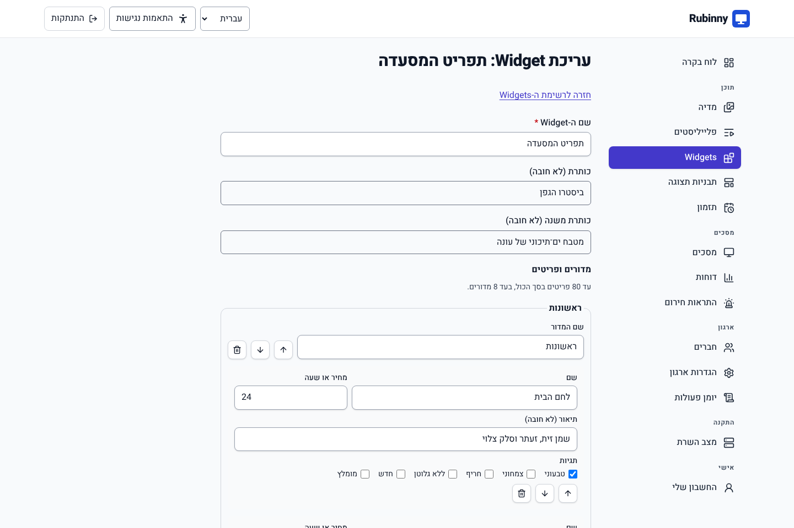 |  |

| מצב מסך: מה מוצג עכשיו, זמינות ושעון                                                 | דוח הצגות עם ייצוא ל-CSV                                                  |
| ------------------------------------------------------------------------------------ | ------------------------------------------------------------------------- |
|  |  |

| תזמון עם ציר זמן שבועי                                                           | Widgets                                             |
| -------------------------------------------------------------------------------- | --------------------------------------------------- |
|  |  |

| לוח בקרה                                        | מצב כהה                                                       |
| ----------------------------------------------- | ------------------------------------------------------------- |
|  |  |

| אודות: קרדיט, רישיון וקוד המקור                | נייד                                                                |
| ---------------------------------------------- | ------------------------------------------------------------------- |
| 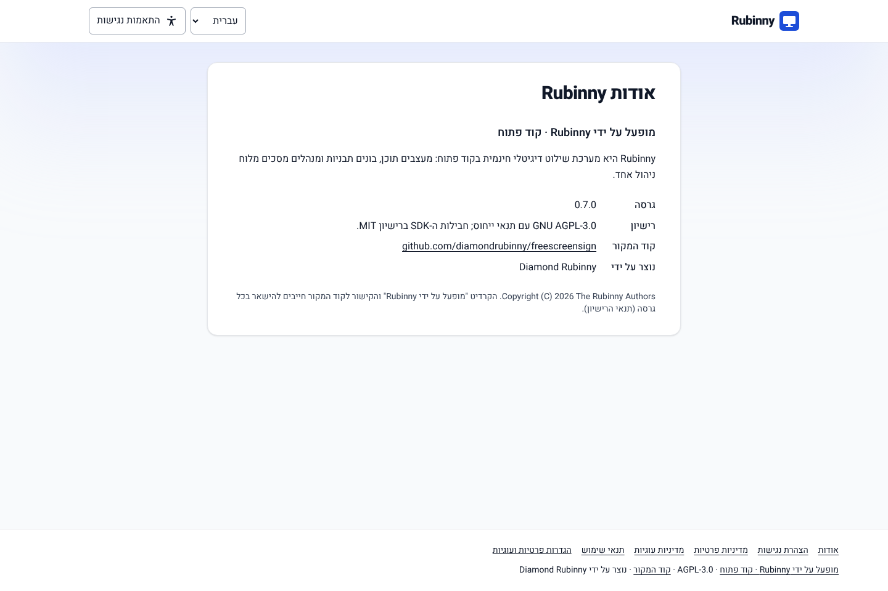 |  |

הצילומים מופקים בפקודה `pnpm --filter @rubinny/cms screens` על התקנת הדגמה (ראו [CONTRIBUTING.md](CONTRIBUTING.md)).

</details>

<div dir="rtl">

### אבטחה ופרטיות מהיסוד

- **התחברות:**
  - עוגיות Session מאובטחות (`__Host-`, ‏HttpOnly).
  - סיסמאות ב-Argon2id ואימות דו-שלבי.
- **הגנות בשרת:**
  - ‏CSP קשיח בכל עמוד.
  - הפרדה מלאה בין ארגונים, עם בדיקות IDOR.
  - הגבלות קצב.
  - Fetch מוגן מ-SSRF עבור RSS, מזג אוויר ותמונות מהמאגר.
- **פרטיות:** בלי Analytics ובלי מעקב של צד שלישי.

פירוט ב-[SECURITY.md](SECURITY.md).

## התקנה מהירה (Docker)

דרישות: Docker עם Compose v2, ובערך 3GB זיכרון (‏ClamAV לבדו צורך כ-1.5–2GB). השרת יכול להיות amd64 או arm64. ב-arm64 צריך להגדיר את `CLAMAV_IMAGE`, כמו שמוסבר ב-`deploy/.env.example`.

</div>

```bash
git clone https://github.com/diamondrubinny/freescreensign.git rubinny
cd rubinny/deploy
./generate-env.sh                 # יוצר .env עם סודות אקראיים
docker compose up -d --build
curl -k https://localhost/health  # {"status":"ok"}
```

<div dir="rtl">

1. **הגדרה ראשונה:** פותחים את https://localhost ומשלימים את ההגדרה עם ה-`SETUP_TOKEN` שבקובץ `deploy/.env`.
2. **חיבור מסך:** בכל מכשיר עם דפדפן פותחים את `https://<הדומיין>/player/` במסך מלא, ומזינים את הקוד שמופיע ב-**מסכים › הוספת מסך**.
   - **למסכים קבועים:** מתקינים נגן. יש אפליקציית מחשב ל-Windows ול-Linux, וקיוסק ל-Raspberry Pi. ההוראות ב-[docs/players.he.md](docs/players.he.md).
3. **פרודקשן:** מגדירים ב-`RUBINNY_DOMAIN` דומיין אמיתי, כדי לקבל תעודת Let's Encrypt אוטומטית.

פיצ'רים אופציונליים, כמו מזג אוויר ומאגר התמונות, מתוארים ב-[`deploy/.env.example`](deploy/.env.example).

**הפעלה בפרודקשן:**

- [צ'קליסט לפני פרודקשן](docs/PRODUCTION-CHECKLIST.md): מה נבדק אוטומטית, מה על המפעיל לעשות, ומה דורש בדיקה מקצועית.
- [תפעול](docs/OPERATIONS.md): גיבויים מוצפנים ושחזור שנבדק, בריאות המערכת, לוגים והתראות.
- [שדרוג](docs/UPGRADING.md): כולל המעבר ל-PostgreSQL 18 ואימות החתימה של images.
- [CHANGELOG](CHANGELOG.md): מה השתנה בכל גרסה.

## מסמכים

- [אפיון ו-Roadmap](docs/PLAN.md)
- [שלב 1 — Foundation](docs/phases/01-foundation.md)
- [שלב 2 — חשבונות וארגונים (שרת)](docs/phases/02-auth-orgs.md) · [CMS](docs/phases/02b-cms.md)
- [שלב 3 — מדיה](docs/phases/03-media.md)
- [שלב 4 — נגן](docs/phases/04-player.md)
- [שלב 5 — תבניות ו-Widgets](docs/phases/05-content.md) · [עיצוב ופיצ'רים](docs/phases/05b-design.md) · [עורך חופשי ומאגר תמונות](docs/phases/05c-designer.md)
- [שלב 6 — תזמון](docs/phases/06-scheduling.md) · [שלב 7 — תפעול](docs/phases/07-ops.md) · [שלב 8 — נגנים לכל מכשיר](docs/phases/08-wrappers.md) · [שלב 9 — הקשחה ושחרור](docs/phases/09-release.md) · [התקנת נגנים](docs/players.he.md) · [שדרוג התקנה קיימת](docs/UPGRADING.md)
- [תרומה לפרויקט](CONTRIBUTING.md) · [אבטחה](SECURITY.md) · [רישוי](LICENSING.md)

**עכשיו:** גרסה v0.7.1. נוסף בה הקרדיט "מופעל על ידי Rubinny · קוד פתוח" בכל חלקי המערכת ([תוכנית ותוצאות](docs/phases/16-attribution.md)).

ב-0.7 נוספו ([תוכנית ותוצאות](docs/phases/15-showcase.md)):

- שבע ערכות מוכנות לפי תחום, עם איורים מקוריים.
- ווידג'ט תפריט ומחירון.
- עורך עיצוב עם מעברי צבע, צללים, גופנים ואנימציות.
- מסכים מתעדכנים לבד אחרי שדרוג השרת.

ב-0.6 נוספו:

- חלון זמן לכל פריט ברשימת השמעה: תאריכים, ימים ושעות.
- קבוצות מסכים: שיוך תוכן לכמה מסכים במכה אחת.
- אזור זמן לכל מסך.
- דף "מצב השרת" למפעיל ההתקנה.
- מסכי Samsung ו-LG: הנגן רץ על Chromium 69, ואפליקציות טעינה לשניהם ([תוכנית](docs/phases/14-tizen-webos.md); עדיין לא נבדק על מכשיר).

ב-0.4 נוספו מסכי מגע, קיר וידאו והצעות ניסוח עם מפתח ה-AI של הארגון. ב-0.3 נוספו התחברות דרך הארגון (SSO) ואישור תוכן. ב-0.2 נוספו טבלאות נתונים, התראות חירום, ‏RLS ו-images ל-arm64.

## תמיכה בפרויקט

‏Rubinny חינמי ויישאר חינמי: כל היכולות, בלי גרסה בתשלום. חסות מממנת את הזמן שמושקע בפרויקט: פיתוח, תיקוני אבטחה, נגישות והממשק בעברית.

[](https://github.com/sponsors/diamondrubinny)

| דרגה   | לחודש | מה מקבלים                                    |
| ------ | ----: | -------------------------------------------- |
| תומך/ת |   ‎$5 | תודה מכל הלב                                 |
| מגבה   |  ‎$25 | השם שלכם ברשימת נותני החסות שבהמשך           |
| ארגון  | ‎$100 | הלוגו שלכם ברשימת נותני החסות                |
| שותף/ה | ‎$500 | לוגו גדול בראש הרשימה, וקול בתכנון ה-Roadmap |

אפשר גם לתת סכום חד-פעמי. חסות היא תרומה לפרויקט: היא לא קונה תמיכה, אחריות או רמת שירות, והרישיון נשאר זהה לכולם.

**נותני חסות:** היו הראשונים!

## רישיון

‏AGPL-3.0, עם חובה לשמור את הקרדיט "Powered by Rubinny". חבילות ה-SDK ברישיון MIT.

נוצר על ידי **Diamond Rubinny**. ראו [AUTHORS.md](AUTHORS.md).

</div>
