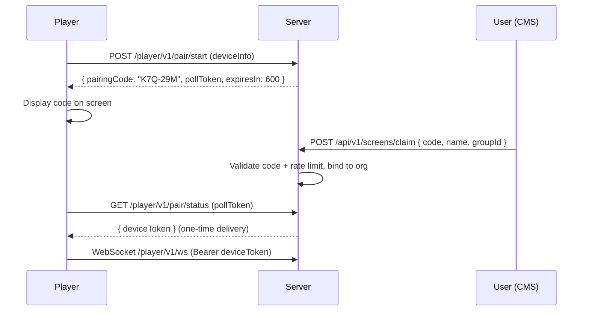
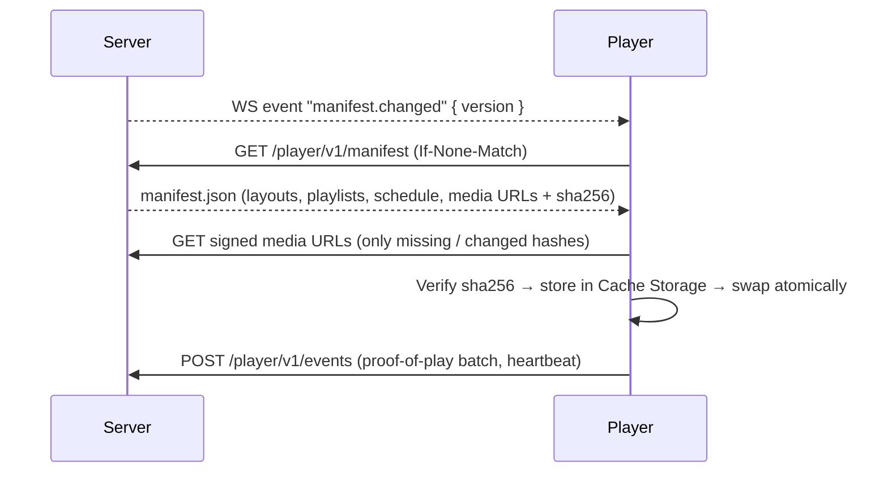
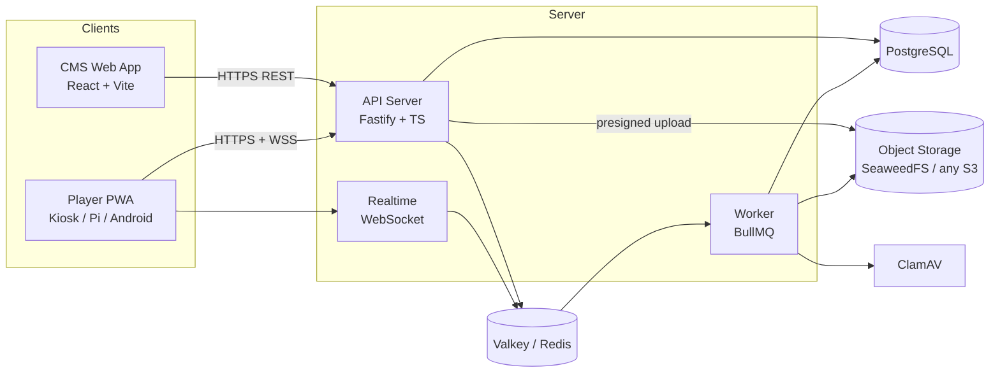

# Rubinny — תוכנית אפיון וארכיטקטורה (שלב 0)

> **סטטוס:** אפיון אושר (2026-10-15). שלב 1 (Foundation) ✅ · שלב 2 (Auth & Orgs: שרת + CMS) ✅ · שלב 3 (Media) ✅ · שלב 4 (Player) ✅ · שלב 5 (Content) ✅ — ראו [`phases/`](phases/).
> **מטרה:** מערכת שילוט דיגיטלי (Digital Signage) בקוד פתוח, חינמית, ניתנת לאירוח עצמי (Self-Hosted), בעלת יכולות ברמה של מערכות מסחריות כמו NoviSign, Yodeck ו-ScreenCloud — עם תמיכה מלאה בעברית ו-RTL מהיום הראשון.

---

## 0. החלטות שאושרו (2026-10-15)

| #   | נושא             | החלטה                                                                                                                                                                                                                                                                                                                                                       |
| --- | ---------------- | ----------------------------------------------------------------------------------------------------------------------------------------------------------------------------------------------------------------------------------------------------------------------------------------------------------------------------------------------------------- |
| D1  | רישיון           | **AGPL-3.0-only** לשרת, ל-CMS, ל-Player ולפריסה. **MIT** ל-`packages/shared`, ל-Widget SDK ול-Player SDK. בנוסף, תנאים לפי **סעיף 7**: חובה לשמור "Powered by Rubinny" ב-CMS (7b), חובה לסמן גרסאות משונות (7c), ואין זכות שימוש בסימן המסחר (7e). פירוט ב-[`LICENSING.md`](../LICENSING.md) וב-[`TRADEMARKS.md`](../TRADEMARKS.md). **דורש בדיקה משפטית.** |
| D2  | חומרה            | **תמיכה בכל הפלטפורמות.** הליבה היא Web Player אחד, ועליו עטיפות לכל פלטפורמה (טבלה למטה).                                                                                                                                                                                                                                                                  |
| D3  | ענן מנוהל        | **כן, בעתיד.** כבר מעכשיו המערכת מתוכננת עם Quotas לכל ארגון, Rate limits, אפשרות לכבות הרשמה, וכלים למניעת ניצול לרעה.                                                                                                                                                                                                                                     |
| D4  | שם ו-Org         | `rubinny` כשם המוצר, `@rubinny/*` כ-npm scope, ו-`rubinny/*` לשמות Docker images. **הדומיין וה-GitHub Org הסופיים טרם נקבעו** (פתוח).                                                                                                                                                                                                                       |
| D5  | Roadmap אחרי MVP | לפי ההמלצה: (1) אינטגרציות נתונים (2) Touch/Kiosk (3) Video Wall (4) AI (Opt-in בלבד).                                                                                                                                                                                                                                                                      |

### מטריצת חומרה (D2)

| פלטפורמה                         | איך                                                  | שלב     |
| -------------------------------- | ---------------------------------------------------- | ------- |
| כל דפדפן מודרני / Chromebook     | PWA ישיר (`https://<domain>/player`)                 | 4       |
| Raspberry Pi 4/5                 | Raspberry Pi OS Lite + Chromium Kiosk + סקריפט התקנה | 8       |
| Linux PC / Mini-PC               | Chromium Kiosk או Electron (AppImage)                | 8       |
| Windows PC                       | Electron (MSI/NSIS) + הפעלה אוטומטית                 | 8       |
| Android / Android TV / Google TV | Capacitor (APK) עם Kiosk mode                        | 8       |
| Amazon Fire TV                   | אותו APK (Fire OS מבוסס Android)                     | 8       |
| Samsung Tizen (SSSP)             | Tizen Web App (`.wgt`) שעוטף את ה-PWA                | 10      |
| LG webOS (Signage)               | webOS Web App (`.ipk`)                               | 10      |
| BrightSign                       | HTML5 על BrightSign                                  | Roadmap |

> הערה: הפצה ל-Tizen/webOS/Fire TV דרך חנויות היצרנים כפופה לתהליכי אישור ולתנאי היצרן. **דורש אימות מול התיעוד הרשמי.**

### מוכנות לענן מנוהל (D3)

- **Quotas לכל ארגון:** מספר מסכים, נפח אחסון, גודל קובץ מקסימלי ומספר משתמשים. ניתנים להגדרה, וב-Self-hosted ללא הגבלה כברירת מחדל.
- **הרשמה:** `REGISTRATION_MODE=open|invite|closed`.
- **מניעת ניצול לרעה:** אימות אימייל חובה, CAPTCHA בהרשמה (ספק שמכבד פרטיות, למשל ALTCHA או Turnstile — **דורש בדיקה**), ודיווח על תוכן פוגעני.
- **מסמכים משפטיים נפרדים** לשירות הענן (תנאי שימוש, DPA, מדיניות שימוש הוגן) — **דורש עו"ד**.

### Roadmap מומלץ (D5)

1. **אינטגרציות נתונים:** Google Sheets ו-CSV, JSON API, RSS מתקדם, Webhooks, ותבניות מבוססות נתונים (תפריטים ומחירונים).
2. **Touch / Kiosk:** אזורים לחיצים, ניווט בין מסכים ו-QR. בלי איסוף מידע אישי.
3. **Video Wall וסנכרון:** סנכרון שעון בין מסכים, חיתוך Canvas ופריסה למספר מסכים.
4. **AI:** יצירת טקסטים ותבניות עם מפתח API של המפעיל (BYO-Key), **Opt-in בלבד**, ושקיפות מלאה לגבי המידע שנשלח לספק.
5. התראות חירום, Workflow אישורים ו-SSO (OIDC).

---

## 1. סיכום ההבנה

Rubinny היא פלטפורמה לניהול מסכים מרחוק:

1. **CMS (לוח ניהול Web)** — העלאת מדיה, עיצוב תצוגות (Layouts) עם אזורים, בניית פלייליסטים, תזמון, ניהול מסכים וקבוצות, משתמשים והרשאות.
2. **Player** — אפליקציה שרצה על המסך (דפדפן Kiosk, Raspberry Pi, Android TV, Windows/Linux), מושכת תוכן, שומרת אותו מקומית ומציגה גם ללא אינטרנט.
3. **Server/API** — מקור האמת, ניהול Tenants, דחיפת עדכונים בזמן אמת, אחסון מדיה, דוחות Proof-of-Play.

הערך: חלופה חינמית ופתוחה למערכות שגובות $10–$30 לחודש למסך, עם קהילה שיכולה להוסיף Widgets, תמיכה בחומרה ושפות.

### נוף קיים (חשוב לבידול)

קיימים כבר פרויקטים פתוחים — **Xibo** (AGPL, PHP), **Anthias / Screenly OSE** (Raspberry Pi), **piSignage**, **Concerto**. הבידול המוצע של Rubinny:

| נושא          | Rubinny                                                         |
| ------------- | --------------------------------------------------------------- |
| Stack         | TypeScript מקצה לקצה, מודרני, קל לתרומה                         |
| Player        | Web-first (PWA) — רץ על כל חומרה עם דפדפן, ובנוסף עטיפות נייטיב |
| שפה           | עברית + RTL כאזרח ראשון, i18n מלא                               |
| התקנה         | `docker compose up` אחד                                         |
| הרחבה         | Widget SDK מתועד ומבודד (iframe sandbox)                        |
| נגישות/פרטיות | מובנות בארכיטקטורה                                              |

> שימו לב: אין להשתמש בשם, לוגו, עיצוב או קוד של NoviSign או מתחרים. "דומה ל-" = ברמת פיצ'רים בלבד.

---

## 2. הנחות עבודה ושאלות הבהרה

### הנחות (ניתן לשנות)

- **H1** מודל: קוד פתוח מלא, Self-Hosted. אופציונלית בעתיד — מופע ענן קהילתי.
- **H2** Multi-tenant מובנה (ארגונים), גם אם רוב ההתקנות יהיו של ארגון יחיד.
- **H3** קהל יעד ראשון: עסקים קטנים-בינוניים, מסעדות, בתי כנסת, מוסדות חינוך, משרדים, קמעונאות.
- **H4** קנה מידה ל-MVP: עד ~1,000 מסכים להתקנה בודדת.
- **H5** Player ראשון: Web Player שרץ ב-Chromium Kiosk (Raspberry Pi / PC / Android עם דפדפן).
- **H6** ממשק: עברית + אנגלית ב-MVP.

### שאלות (נענו — ההחלטות בסעיף 0)

1. **רישיון:** ממליץ **AGPL-3.0** לשרת ו-CMS (מונע ממי שמוכר SaaS סגור על בסיס הקוד להסתיר שינויים) + **MIT** ל-Player SDK ול-Widget SDK (מעודד אימוץ). חלופה: Apache-2.0 לכל הפרויקט (יותר מתירני, פחות הגנה). מה מעדיף?
2. **חומרה מועדפת לשלב 1:** Raspberry Pi? Android TV / Fire TV? Samsung Tizen / LG webOS? Windows PC?
3. **מופע ענן מנוהל:** האם תרצה בעתיד להפעיל שירות ענן חינמי (משפיע על Rate limits, Quotas, ותנאי שימוש)?
4. **שם דומיין / GitHub Org** לפרויקט (לתיעוד, Docker images, חבילות npm `@rubinny/*`)?
5. **פיצ'רים מתקדמים מועדפים** אחרי MVP: Video Wall? Touch/Kiosk אינטראקטיבי? אינטגרציות (Google Sheets, Power BI, Instagram)? AI ליצירת תוכן?

---

## 3. היקף MVP

### בתוך ה-MVP

- התקנה ב-Docker Compose.
- ארגונים, משתמשים, תפקידים (Owner / Admin / Editor / Viewer).
- התחברות (סיסמה + Argon2id), איפוס סיסמה, אימות אימייל, **MFA (TOTP)** לאדמינים.
- ספריית מדיה: תמונות (JPG/PNG/WebP), וידאו (MP4/H.264, WebM), PDF (המרה לתמונות) — כולל סריקת ClamAV.
- Widgets מובנים: שעון/תאריך (כולל תאריך עברי), טקסט/טיקר, דף אינטרנט (URL), RSS, מזג אוויר, QR, YouTube.
- Layouts עם אזורים (Zones) ותבניות מוכנות (מסך מלא, 2 אזורים, L-Bar, טיקר תחתון).
- Playlists: סדר, משך לכל פריט, מעברים בסיסיים.
- תזמון: לפי תאריכים, ימים בשבוע, שעות, עדיפויות; כולל ברירת מחדל.
- מסכים: Pairing בקוד, קבוצות, תגיות, סטטוס Online/Offline, צילום מסך מרחוק.
- Player: Offline-first, Cache מקומי, Heartbeat, עדכון בזמן אמת ב-WebSocket.
- Proof-of-Play בסיסי (מה הוצג, מתי, על איזה מסך).
- Audit Log לפעולות רגישות.
- עברית/אנגלית, RTL, WCAG 2.1 AA ב-CMS.

### מחוץ ל-MVP (Roadmap)

Video Wall וסנכרון בין מסכים · Touch/אינטראקטיביות · Tizen/webOS נייטיב · Data-driven templates (Google Sheets/CSV/API) · Workflow אישורי תוכן · SSO (OIDC/SAML) · Marketplace ל-Widgets · Emergency Alerts · אנליטיקת קהל (מחייבת בדיקת פרטיות מיוחדת!) · AI.

---

## 4. User Stories

| #    | כ...             | אני רוצה...                       | כדי ש...                                    |
| ---- | ---------------- | --------------------------------- | ------------------------------------------- |
| US1  | מנהל מערכת       | להתקין עם פקודה אחת               | אתחיל לעבוד תוך דקות                        |
| US2  | בעל ארגון        | להזמין משתמשים עם תפקידים         | לחלק אחריות בבטחה                           |
| US3  | עורך תוכן        | להעלות תמונות ווידאו              | אשתמש בהן בפלייליסטים                       |
| US4  | עורך תוכן        | לבנות פלייליסט בגרירה             | אקבע סדר ומשך                               |
| US5  | עורך תוכן        | לעצב Layout עם אזורים             | אציג כמה תכנים במקביל                       |
| US6  | עורך תוכן        | לתזמן תוכן לפי שעות/ימים          | תפריט בוקר יוחלף בצהריים                    |
| US7  | מתקין            | להציג קוד Pairing על מסך חדש      | אחבר אותו לארגון בלי להקליד סיסמאות על המסך |
| US8  | מנהל             | לראות אילו מסכים לא מחוברים       | אטפל בתקלות                                 |
| US9  | מנהל             | לשנות תוכן ולראות אותו מתעדכן מיד | אגיב לאירועים                               |
| US10 | בעל מסך          | שהמסך ימשיך לנגן ללא אינטרנט      | לא יהיה מסך שחור                            |
| US11 | מפרסם            | דוח מה הוצג ומתי                  | אוכיח חשיפה ללקוח                           |
| US12 | מפתח קהילה       | לכתוב Widget חדש עם SDK           | אתרום לפרויקט                               |
| US13 | משתמש עם מוגבלות | לנווט ב-CMS במקלדת וקורא מסך      | אוכל לעבוד בשוויון                          |

---

## 5. מסכים וזרימות

### CMS

1. התקנה ראשונית (Setup Wizard — יצירת Owner ראשון)
2. התחברות / הרשמה / שכחתי סיסמה / MFA
3. Dashboard — סטטוס מסכים, פעילות אחרונה
4. מסכים — רשימה, פרטי מסך, Pairing, קבוצות
5. מדיה — ספרייה, העלאה, תיקיות, תצוגה מקדימה
6. פלייליסטים — רשימה, עורך (Drag & Drop)
7. Layouts — רשימה, Designer (Canvas עם Zones)
8. תזמונים — לוח שנה / Timeline
9. Widgets — הגדרה של מופעי Widget
10. דוחות — Proof-of-Play, Uptime
11. הגדרות ארגון — משתמשים, תפקידים, API Keys, Webhooks
12. הגדרות אישיות — פרופיל, MFA, שפה, ייצוא/מחיקת מידע אישי
13. Audit Log
14. עמודים קבועים: הצהרת נגישות, פרטיות, עוגיות, תנאי שימוש, 404, Error

### זרימת Pairing



### זרימת תוכן ל-Player



---

## 6. ארכיטקטורה



- **API ו-WS באותו תהליך ב-MVP** (פשוט להתקנה), עם Redis Pub/Sub כדי לאפשר Scale-out אופקי בהמשך.
- **Worker נפרד** לעיבוד מדיה (סריקה, Thumbnails, המרות ffmpeg/PDF) — רץ בקונטיינר מבודד, ללא הרשאות רשת מיותרות, עם מגבלות CPU/RAM/זמן.
- **Player** מקבל Manifest דקלרטיבי ולא קוד — אין הרצת קוד שרת על המסך.

### מחזור חיים של העלאת קובץ

`Client → presigned PUT ל-bucket quarantine → API מאשר → Worker: בדיקת magic bytes + MIME + גודל → ClamAV → (נקי) עיבוד ב-sandbox → העברה ל-bucket media → status=ready | (חשוד) status=blocked + Audit + התראה`

---

## 7. החלטות טכנולוגיות וחלופות

| רכיב          | בחירה                                                               | למה                                                                               | חלופות                                                             | מגבלות                                                                                        |
| ------------- | ------------------------------------------------------------------- | --------------------------------------------------------------------------------- | ------------------------------------------------------------------ | --------------------------------------------------------------------------------------------- |
| שפה           | TypeScript 6.0                                                      | טיפוסים משותפים לכל הרכיבים, קהילה גדולה                                          | Go, Python                                                         | TS 7 (native) עדיין לא נתמך ב-typescript-eslint, ולכן נשארים על 6.0 בינתיים                   |
| Monorepo      | pnpm workspaces + Turborepo                                         | שיתוף טיפוסים וסכמות                                                              | Nx, Lerna                                                          | עקומת למידה קלה                                                                               |
| API           | Fastify                                                             | מהיר, סכמות JSON מובנות, plugins לאבטחה                                           | NestJS, Express, Hono                                              | פחות "opinionated" מ-Nest                                                                     |
| ולידציה       | Zod (משותף לקליינט ושרת)                                            | Single source of truth                                                            | Valibot, TypeBox                                                   | —                                                                                             |
| גישה ל-DB     | **Kysely** + Migrations ב-SQL ו-migrator עצמי                       | שאילתות פרמטריות עם טיפוסים, בלי codegen ובלי מנוע בינארי, עובד ב-image read-only | Prisma 7/8 (driver adapters + codegen, ו-v8 עדיין ב-RC), Drizzle   | הטיפוסים נכתבים ידנית ב-`db/schema.ts`                                                        |
| DB            | PostgreSQL 18                                                       | אמין, JSONB, RLS אפשרי                                                            | MySQL, SQLite (להתקנות זעירות)                                     | —                                                                                             |
| Queue/Cache   | **Valkey 9** (תואם Redis, רישיון BSD) + BullMQ                      | תורים, Pub/Sub, Rate limit                                                        | Redis 8, RabbitMQ, pg-boss                                         | תלות נוספת                                                                                    |
| אחסון         | S3-compatible — **SeaweedFS** (Apache-2.0) ב-Docker                 | Presigned URLs, תואם לכל ספק S3 (AWS, R2, Garage ועוד)                            | Garage, דיסק מקומי                                                 | **MinIO נפסל:** פרויקט ה-Community הפסיק להפיץ images ב-2025, עבר למצב תחזוקה ובהמשך לארכיון. |
| Runtime       | Node.js 24 LTS ב-Docker, ≥22.12 בפיתוח                              | —                                                                                 | Bun, Deno                                                          | —                                                                                             |
| אנטי-וירוס    | ClamAV (clamd)                                                      | קוד פתוח, סטנדרטי                                                                 | שירות מנוהל                                                        | צורך RAM (~1–2GB)                                                                             |
| מדיה          | ffmpeg, pdftoppm/poppler, sharp                                     | סטנדרט                                                                            | —                                                                  | חייב sandbox                                                                                  |
| CMS           | React 18 + Vite + TanStack Router/Query                             | SPA קל לאירוח, מהיר                                                               | Next.js, SvelteKit                                                 | SEO לא נדרש ב-CMS                                                                             |
| UI            | Radix UI + Tailwind (עם logical properties ל-RTL)                   | רכיבים נגישים                                                                     | MUI, Mantine                                                       | —                                                                                             |
| i18n          | i18next                                                             | ICU, RTL, pluralization                                                           | FormatJS                                                           | —                                                                                             |
| Player        | PWA (Vite + TS, ללא framework כבד) + Service Worker + IndexedDB     | רץ בכל דפדפן מודרני                                                               | React                                                              | הגבלות Autoplay/Storage בדפדפנים                                                              |
| עטיפות Player | Chromium kiosk (Pi), Electron (Win/Linux), Android WebView (Java)   | שימוש חוזר בקוד ה-Web                                                             | נייטיב מלא                                                         | לכל עטיפה עלות תחזוקה                                                                         |
| Auth          | מימוש מבוסס ספריות מוכרות: Argon2id, sessions ב-DB, `otplib` ל-TOTP | שליטה מלאה ב-Self-hosted                                                          | Lucia (deprecated כספרייה — **דורש אימות**), Better-Auth, Keycloak | אחריות אבטחה עלינו → בדיקות + PenTest                                                         |
| בדיקות        | Vitest, Playwright, axe-core                                        | —                                                                                 | Jest, Cypress                                                      | —                                                                                             |
| CI            | GitHub Actions + CodeQL + Dependabot + Trivy                        | חינמי לקוד פתוח                                                                   | —                                                                  | —                                                                                             |

---

## 8. סכמת בסיס נתונים (טיוטה)

```prisma
model Organization { id String @id @default(uuid()) name String slug String @unique createdAt DateTime @default(now()) deletedAt DateTime? }

model User {
  id String @id @default(uuid())
  email String @unique            // citext
  passwordHash String              // argon2id
  emailVerifiedAt DateTime?
  mfaSecretEnc Bytes?              // encrypted at rest (AES-256-GCM, key from env/KMS)
  locale String @default("he")
  createdAt DateTime @default(now())
  deletedAt DateTime?
}

model Membership { id String @id @default(uuid()) userId String orgId String role Role  @@unique([userId, orgId]) }
enum Role { OWNER ADMIN EDITOR VIEWER }

model Session { id String @id  // sha256 of token
  userId String expiresAt DateTime lastSeenAt DateTime ipHash String? userAgent String? }

model Screen {
  id String @id @default(uuid())
  orgId String
  name String
  groupId String?
  tokenHash String @unique         // device token hashed
  status ScreenStatus @default(OFFLINE)
  lastSeenAt DateTime?
  resolution String? orientation Orientation @default(LANDSCAPE)
  timezone String @default("Asia/Jerusalem")
  playerVersion String?
  tags String[]
}

model ScreenGroup { id String @id orgId String name String }
model PairingCode { codeHash String @id pollTokenHash String deviceInfo Json expiresAt DateTime claimedScreenId String? }

model Media {
  id String @id @default(uuid())
  orgId String folderId String?
  originalName String               // sanitized, display only
  storageKey String                 // random uuid key
  mime String sizeBytes BigInt sha256 String
  width Int? height Int? durationMs Int?
  status MediaStatus @default(QUARANTINE)   // QUARANTINE | SCANNING | PROCESSING | READY | BLOCKED | FAILED
  createdById String createdAt DateTime @default(now())
}

model Playlist { id String @id orgId String name String items PlaylistItem[] }
model PlaylistItem { id String @id playlistId String position Int kind ItemKind  // MEDIA | WIDGET | PLAYLIST
  mediaId String? widgetId String? durationMs Int transition String? }

model Widget { id String @id orgId String type String  // "clock", "rss", "weather"...
  config Json   // validated by widget's Zod schema
  name String }

model Layout { id String @id orgId String name String width Int height Int background String?
  zones Zone[] }
model Zone { id String @id layoutId String name String x Int y Int w Int h Int z Int playlistId String? }

model Schedule { id String @id orgId String name String priority Int
  targetType TargetType targetId String   // SCREEN | GROUP | TAG
  layoutId String
  startsAt DateTime? endsAt DateTime?
  rrule String?                           // RFC 5545
  timeFrom String? timeTo String? daysOfWeek Int[] }

model PlayEvent { id BigInt @id @default(autoincrement()) orgId String screenId String
  itemRef String startedAt DateTime durationMs Int }    // partition by month

model AuditLog { id BigInt @id @default(autoincrement()) orgId String? actorId String? action String
  targetType String? targetId String? ipHash String? createdAt DateTime @default(now()) meta Json }

model ApiKey { id String @id orgId String name String keyHash String scopes String[] lastUsedAt DateTime? }
```

**עקרונות:** כל טבלה עסקית כוללת `orgId`; כל שאילתה עוברת דרך שכבת Repository שמחייבת `orgId` (הגנת IDOR/BOLA). שקילה: Postgres Row-Level Security כהגנת עומק.

---

## 9. API Endpoints (טיוטה)

**ציבורי (ללא התחברות, עם Rate Limit):**
`POST /api/v1/auth/login` · `POST /auth/register` (ניתן לכיבוי) · `POST /auth/forgot` · `POST /auth/reset` · `POST /auth/verify-email` · `GET /health` · `POST /player/v1/pair/start` · `GET /player/v1/pair/status`

**מחייב Session (CMS) + הרשאה לפי תפקיד:**

| Resource                                  | Endpoints                                                                                                      | הרשאה מינימלית         |
| ----------------------------------------- | -------------------------------------------------------------------------------------------------------------- | ---------------------- |
| Auth                                      | `POST /auth/logout`, `POST /auth/mfa/setup`, `POST /auth/mfa/verify`                                           | משתמש                  |
| Me                                        | `GET/PATCH /me`, `GET /me/export`, `DELETE /me`                                                                | משתמש                  |
| Orgs                                      | `GET /orgs`, `PATCH /orgs/:id`, `GET/POST/DELETE /orgs/:id/members`                                            | Admin                  |
| Screens                                   | `GET/POST(claim)/PATCH/DELETE /screens`, `POST /screens/:id/screenshot`, `POST /screens/:id/reload`            | Editor (מחיקה: Admin)  |
| Groups                                    | CRUD `/screen-groups`                                                                                          | Editor                 |
| Media                                     | `POST /media/uploads` (presign), `POST /media/:id/complete`, `GET /media`, `GET /media/:id`, `PATCH`, `DELETE` | Editor                 |
| Playlists / Layouts / Widgets / Schedules | CRUD                                                                                                           | Editor (קריאה: Viewer) |
| Reports                                   | `GET /reports/proof-of-play`, `GET /reports/uptime`                                                            | Viewer                 |
| Audit                                     | `GET /audit`                                                                                                   | Admin                  |
| API Keys                                  | CRUD `/api-keys`                                                                                               | Admin                  |

**Player (Bearer deviceToken):**
`GET /player/v1/manifest` · `GET /player/v1/media/:id` (redirect ל-signed URL קצר-מועד) · `POST /player/v1/events` · `POST /player/v1/screenshot` · `WSS /player/v1/ws`

**API ציבורי לאינטגרציות:** אותם endpoints תחת API Key עם Scopes; OpenAPI אוטומטי מ-Fastify/Zod.

---

## 10. מבנה תיקיות

```
rubinny/
├─ apps/
│  ├─ server/          # Fastify API + WS
│  │  ├─ src/{modules/<domain>/{routes,service,repo,schema}.ts, plugins, lib}
│  │  └─ prisma/
│  ├─ worker/          # BullMQ media pipeline (scan, thumbnails, transcode)
│  ├─ cms/             # React admin
│  ├─ player/          # PWA player
│  ├─ desktop/         # Electron wrapper (Windows, Linux)
│  └─ android/         # Android / Android TV WebView app (Java)
├─ packages/
│  ├─ shared/          # Zod schemas, types, manifest spec
│  ├─ widget-sdk/      # API for community widgets (MIT)
│  ├─ widgets/         # Built-in widgets (clock, rss, weather, ...)
│  ├─ ui/              # Accessible RTL-ready components
│  └─ i18n/            # he, en locales
├─ deploy/
│  ├─ docker-compose.yml
│  ├─ Caddyfile        # auto HTTPS + security headers
│  ├─ generate-env.sh  # creates .env with random secrets
│  ├─ seaweedfs/       # S3 storage entrypoint
│  ├─ kiosk/raspberry-pi/  # Raspberry Pi kiosk installer (cage + Chromium)
│  └─ .env.example
├─ docs/               # PLAN.md, ARCHITECTURE.md, SECURITY.md, legal drafts
├─ .github/            # CI, issue templates, CODEOWNERS
├─ README.md  CONTRIBUTING.md  CODE_OF_CONDUCT.md  SECURITY.md  LICENSE
```

---

## 11. Threat Model (מקוצר)

| נכס                          | איום                                                | סיכון       | בקרה                                                                                                    |
| ---------------------------- | --------------------------------------------------- | ----------- | ------------------------------------------------------------------------------------------------------- |
| חשבונות משתמשים              | Brute force, Credential stuffing                    | גבוה        | Rate limit לפי IP+חשבון, השהיה מדורגת, MFA, Argon2id, הודעות שגיאה גנריות                               |
| מסכים                        | השתלטות והצגת תוכן זדוני (נזק תדמיתי חמור)          | **גבוה**    | Device token אקראי 256bit מאוחסן כ-hash, רוטציה, ביטול מיידי, Pairing code חד-פעמי + תפוגה + Rate limit |
| הפרדת ארגונים                | IDOR/BOLA                                           | גבוה        | `orgId` חובה בכל repo, בדיקות אוטומטיות חוצות-Tenant, RLS כהגנת עומק                                    |
| העלאות                       | נוזקות, Polyglot files, Zip bombs, ניצול ffmpeg/PDF | גבוה        | Allowlist, magic bytes, גבולות גודל/רזולוציה/משך, ClamAV, Quarantine, עיבוד ב-sandbox ללא רשת           |
| Widget "דף אינטרנט"/RSS/טבלה | SSRF מהשרת                                          | בינוני-גבוה | ה-RSS/Weather/טבלאות נשלפים דרך Fetch Proxy עם חסימת IP פרטיים/metadata, allowlist פרוטוקולים, timeouts |
| Widgets קהילתיים             | XSS / הרצת קוד                                      | גבוה        | הרצה ב-`iframe sandbox` עם CSP קשיח, postMessage API מוגדר, ללא גישה ל-token של המכשיר                  |
| CMS                          | XSS, CSRF, Clickjacking                             | בינוני      | React escaping, CSP, SameSite=Lax + אימות `Origin`/`Sec-Fetch-Site`, `frame-ancestors 'none'`           |
| סודות                        | דליפה                                               | גבוה        | ENV בלבד, `.env.example`, Secret scanning ב-CI, לוגים מסוננים (pino redact)                             |
| שרשרת אספקה                  | תלויות זדוניות                                      | בינוני      | lockfile, Dependabot, `pnpm audit`, Trivy, SBOM (CycloneDX), חתימת images (cosign)                      |

**כותרות אבטחה (Caddy):** HSTS, CSP, X-Content-Type-Options, Referrer-Policy, Permissions-Policy, frame-ancestors.
**Cookies של Session:** `__Host-` prefix, Secure, HttpOnly, SameSite=Lax, תפוגה מתגלגלת.

---

## 12. פרטיות — Data Map ראשוני

| סוג מידע                                        | מקור                               | מטרה           | בסיס עיבוד (GDPR)     | אחסון          | שמירה                | צד ג'                               |
| ----------------------------------------------- | ---------------------------------- | -------------- | --------------------- | -------------- | -------------------- | ----------------------------------- |
| אימייל, שם                                      | משתמש                              | חשבון והתחברות | חוזה                  | PostgreSQL     | חיי החשבון + 30 יום  | שרת מייל (SMTP שהמתקין בוחר)        |
| Hash סיסמה, סוד MFA (מוצפן)                     | משתמש                              | אבטחה          | חוזה                  | PostgreSQL     | חיי החשבון           | —                                   |
| IP (hashed), User-Agent                         | בקשות                              | אבטחה, Audit   | אינטרס לגיטימי        | PostgreSQL     | 90 יום               | —                                   |
| Audit Log                                       | מערכת                              | אבטחה ובקרה    | אינטרס לגיטימי / חובה | PostgreSQL     | 1 שנה (ניתן להגדרה)  | —                                   |
| מדיה שהועלתה                                    | משתמש                              | הצגה במסכים    | חוזה                  | Object Storage | עד מחיקה             | —                                   |
| Proof-of-Play                                   | Player                             | דוחות          | חוזה / אינטרס לגיטימי | PostgreSQL     | 90 יום (ניתן להגדרה) | —                                   |
| זמינות מסך, סטיית שעון                          | Player                             | ניטור          | אינטרס לגיטימי        | PostgreSQL     | 90 יום               | —                                   |
| התראות ניתוק (מייל)                             | מערכת                              | תפעול          | אינטרס לגיטימי        | —              | לא נשמר              | שרת מייל (SMTP)                     |
| צילומי מסך מרחוק (האחרון לכל מסך, ללא מטא-דאטה) | Player (Electron/Android)          | תמיכה ובקרה    | אינטרס לגיטימי        | PostgreSQL     | 7 ימים               | —                                   |
| מפתח מכשיר (hash), סוג וגרסת נגן, רזולוציה      | Player                             | הפעלת המסך     | חוזה                  | PostgreSQL     | עד מחיקת המסך        | —                                   |
| גיבויים (מוצפנים, age)                          | מפעיל                              | שחזור          | אינטרס לגיטימי        | לפי המפעיל     | לפי מדיניות המפעיל   | לפי המפעיל                          |
| התראות חירום (כותרת, הודעה, מי הפעיל ומי סיים)  | משתמש                              | בטיחות         | אינטרס לגיטימי        | PostgreSQL     | עד מחיקת הארגון      | —                                   |
| נתוני Widget טבלה (עשויים לכלול שמות)           | מקור שהארגון בחר (Sheets/CSV/JSON) | הצגה במסכים    | חוזה                  | Valkey (מטמון) | עד 24 שעות           | ספק המקור (מקבל את כתובת השרת בלבד) |

**הערות:**

- **Rubinny כפרויקט אינו מעבד מידע** — כל התקנה היא של המפעיל, שהוא ה-Controller. נספק כלים ותבניות, לא ייעוץ משפטי.
- **אין טלמטריה כברירת מחדל.** אם תתווסף — Opt-in בלבד, אנונימית, ומתועדת.
- תוכן שמוצג במסכים עשוי לכלול מידע אישי (שמות עובדים, תמונות) — אחריות המפעיל; נתריע ב-UI.
- **ישראל:** חוק הגנת הפרטיות ותיקון 13, תקנות אבטחת מידע — רלוונטי למפעילים; **דורש בדיקה משפטית** לכל מפעיל.
- מצלמות/אנליטיקת קהל — **לא ב-MVP**, מחייב DPIA ובדיקה משפטית ייעודית.

---

## 13. עוגיות ו-Trackers

| שם                                                   | סוג                                     | קטגוריה         | מטרה                      | משך                                | צד ג' | הסכמה                                        |
| ---------------------------------------------------- | --------------------------------------- | --------------- | ------------------------- | ---------------------------------- | ----- | -------------------------------------------- |
| `__Host-rubinny_session` (בפיתוח: `rubinny_session`) | Cookie (HttpOnly, Secure, SameSite=Lax) | חיונית          | חיבור (Session)           | 14 יום מתגלגל, עד 30 יום לכל היותר | לא    | לא נדרשת                                     |
| `rubinny.locale`                                     | localStorage                            | העדפות          | שפת הממשק                 | עד מחיקה                           | לא    | **לבדיקה משפטית**: ייתכן שנחשב "נחוץ במפורש" |
| `rubinny.a11y`                                       | localStorage                            | העדפות / נגישות | התאמות הנגישות שנבחרו     | עד מחיקה                           | לא    | **לבדיקה משפטית**: ייתכן שנחשב "נחוץ במפורש" |
| נגן: מפתח מכשיר, Manifest, יומן הצגות                | localStorage + Cache Storage (במסך)     | חיונית          | הפעלת המסך, ניגון Offline | עד ביטול צימוד המסך                | לא    | לא נדרשת (מכשיר של המפעיל, לא של צופה)       |

הגנת CSRF נעשית בבדיקת `Origin` / `Sec-Fetch-Site` ובעוגיית SameSite, בלי עוגייה נוספת.

**ב-MVP אין Analytics/פיקסלים.** בכל זאת ייבנה רכיב Consent Manager (אישור הכל / דחיית הכל / ניהול העדפות, קישור קבוע ב-Footer) כדי שמפעילים שיוסיפו כלים יחויבו לעבור דרכו.
**Player:** אינו משתמש בעוגיות. מפתח המכשיר נשמר ב-localStorage של הנגן, ובאפליקציית Android באחסון הפרטי של האפליקציה, ואינו נכלל בגיבויים.

---

## 14. נגישות

- יעד: **WCAG 2.1 AA** ב-CMS, ובדיקת התאמה ל-**ת"י 5568** — דורש אימות מול יועץ נגישות.
- רכיבי Radix (ARIA תקין), ניווט מקלדת מלא כולל Designer (הזזת Zones במקלדת בחיצים), Focus visible, Skip link.
- `dir="rtl"` דינמי + CSS logical properties בלבד (`margin-inline-start` וכו').
- תמיכה ב-`prefers-reduced-motion`, ניגודיות ≥ 4.5:1, זום 200%.
- axe-core ב-Playwright ב-CI על כל עמוד.
- עמוד "הצהרת נגישות" (טיוטה) + תפריט התאמות נגישות קל משקל.
- **תוכן המסכים:** כלי עזר למפעיל — בודק ניגודיות בתבניות, מהירות טיקר מומלצת, אזהרה על הבהובים (> 3 לשנייה).

---

## 15. תוכנית עבודה בשלבים

| שלב                         | תוצר                                                                                                                                            | הערות                                                  |
| --------------------------- | ----------------------------------------------------------------------------------------------------------------------------------------------- | ------------------------------------------------------ |
| **0**                       | אפיון (מסמך זה) + החלטות רישיון                                                                                                                 | ✅                                                     |
| **1 — Foundation**          | Monorepo, CI (lint/typecheck/test/CodeQL), Docker Compose (Postgres, Valkey, SeaweedFS, ClamAV, Caddy), README, CONTRIBUTING, SECURITY, LICENSE | ✅                                                     |
| **2 — Auth & Orgs**         | הרשמה/התחברות/איפוס/אימות אימייל/MFA, ארגונים, תפקידים, Audit, Rate limit                                                                       | ✅ שרת + CMS · בדיקות חוצות-Tenant                     |
| **3 — Media**               | Streaming upload, Quarantine, ClamAV, Thumbnails, ספריית מדיה ב-CMS                                                                             | ✅                                                     |
| **4 — Player Core**         | Pairing, Manifest spec, Offline cache, ניגון תמונה/וידאו מסך מלא, Heartbeat, WS                                                                 | ✅ נקודת "Demo" ראשונה                                 |
| **5 — Content**             | Playlists, Layouts+Zones Designer, Widgets מובנים + Widget SDK                                                                                  | ✅                                                     |
| **6 — Scheduling**          | מנוע תזמון (ימים, שעות, תאריכים, עדיפויות, אזורי זמן), תצוגת Timeline                                                                           | ✅ RRULE מלא וחגים — Roadmap                           |
| **7 — Ops**                 | Proof-of-Play, Uptime, צילום מסך, Reload מרחוק, התראות Offline במייל                                                                            | ✅ צילום מסך אמיתי — שלב 8                             |
| **8 — Wrappers**            | Electron (Windows/Linux), Raspberry Pi kiosk, Android / Android TV, צילום מסך מרחוק                                                             | ✅ סקריפט התקנה ל-Pi במקום תמונת מערכת · בלי חתימת קוד |
| **9 — Hardening & Release** | PenTest פנימי, בדיקות נגישות, טיוטות משפטיות, תיעוד, v0.1.0                                                                                     | Checklist פרודקשן                                      |
| **10 — Signage OS**         | Samsung Tizen, LG webOS                                                                                                                         | אחרי v0.1                                              |
| **11+**                     | Roadmap D5                                                                                                                                      |                                                        |

---

## 16. סיכונים ונושאים לבדיקה מקצועית

- **טכני:** מגבלות Autoplay ו-Storage quota בדפדפנים (פתרון: Kiosk flags, `navigator.storage.persist()`); ניגון וידאו חלק על Pi (H.264 hardware decoding); סנכרון שעון למסכים (NTP / offset מהשרת).
- **קהילה:** קיימות חלופות פתוחות ותיקות — צריך בידול ברור וחוויית התקנה מצוינת.
- **אבטחה:** מסך פרוץ = נזק תדמיתי פומבי. נדרש PenTest לפני v1.0.
- **רישוי:** בדיקת תאימות רישיונות התלויות (ffmpeg codecs — פטנטים על H.264/HEVC בחלק מהמדינות) — **דורש בדיקה משפטית**.
- **מותג:** בדיקת זמינות סימן מסחר "Rubinny" ודומיין — **דורש בדיקה משפטית**.
- **משפטי:** טיוטות פרטיות/תנאים/עוגיות/נגישות — טיוטות טכניות בלבד, מחייבות עו"ד/ממונה פרטיות/יועץ נגישות.

---

## 17. הצעד הבא המומלץ

**שלב 9 — Hardening & Release:**

- **בדיקת חדירות פנימית:** לכל ה-API, הנגן והעטיפות.
- **בדיקות נגישות ידניות:** קורא מסך, מקלדת וזום 200%.
- **צ'קליסט פרודקשן:** כולל טבלת המידע האישי, רשימת העוגיות וטיוטות המסמכים המשפטיים.
- **תיעוד ושחרור v0.1.0:**
  - **חתימה:** אפשרות לחתימת קוד לעטיפות, אם יהיה מפתח מפרסם.
  - **ארטיפקטים:** פרסום של קובצי ההתקנה כ-Release.

תוכנית מפורטת תיכתב ב-`docs/phases/09-release.md` לפני תחילת הפיתוח.
