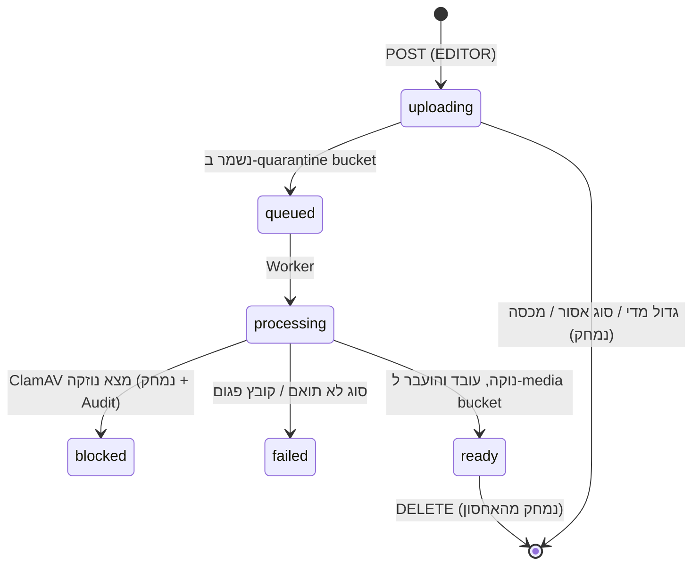

# שלב 3 — Media: העלאה מאובטחת וספריית מדיה ✅

**מטרה:** העלאת תמונות וסרטונים לארגון, סריקה לנוזקות, אימות סוג הקובץ, ניקוי מטא-דאטה, יצירת תמונות ממוזערות, וספריית מדיה נגישה ב-CMS. כל זה תוך שמירה על בידוד, מכסות ואבטחה לפי הדרישות.

## 1. החלטות ושינויים מהאפיון

| נושא        | החלטה                                                                                       | למה                                                                                                                                                           |
| ----------- | ------------------------------------------------------------------------------------------- | ------------------------------------------------------------------------------------------------------------------------------------------------------------- |
| נתיב ההעלאה | **סטרימינג דרך ה-API** אל bucket ההסגר (במקום presigned URL ישיר ל-S3)                      | ה-S3 נשאר ברשת הפנימית בלבד. ה-API אוכף הרשאה, מכסה, Rate limit וגודל לפני השמירה. ה-CSP נשאר `connect-src 'self'`, ואין צורך ב-CORS או בדומיין ציבורי לאחסון |
| הגשת קבצים  | דרך ה-API, עם בדיקת הרשאה ותמיכה ב-HTTP Range (לווידאו)                                     | אותה בקרת גישה כמו לשאר הנתונים. ל-Player יהיה endpoint משלו בשלב 4                                                                                           |
| Worker      | **תהליך נפרד מאותו קוד** (`apps/server/src/worker`), ב-image נפרד שכולל ffmpeg              | הקוד המשותף (DB, S3, תורים) נשאר אחד. ה-Worker רץ בקונטיינר מבודד עם מגבלות משאבים                                                                            |
| תור         | **BullMQ** מעל Valkey (`maxmemory-policy noeviction`)                                       | ניסיונות חוזרים, backoff וכשלים שלא ינוסו שוב                                                                                                                 |
| S3          | `@aws-sdk/client-s3` + `lib-storage` (multipart upload), `forcePathStyle`                   | תואם SeaweedFS, AWS, R2 ו-Garage                                                                                                                              |
| עיבוד תמונה | **sharp** (libvips)                                                                         | מהיר, מגבלת פיקסלים מובנית                                                                                                                                    |
| עיבוד וידאו | **ffprobe/ffmpeg**, remux בלבד (`-c copy`), בלי קידוד מחדש                                  | זול. מסיר מטא-דאטה, כולל מיקום GPS מטלפונים, ומוסיף `faststart` לניגון מהיר                                                                                   |
| זיהוי סוג   | **file-type** (magic bytes), גם בהעלאה וגם ב-Worker                                         | סוג הקובץ נקבע לפי התוכן, לא לפי הסיומת או ה-MIME שהדפדפן הצהיר                                                                                               |
| סריקה       | **ClamAV** (פרוטוקול `INSTREAM` ב-TCP, מימוש עצמי ~40 שורות). `StreamMaxLength` הוגדל ל-1GB | ברירת המחדל של התמונה היא 25MB                                                                                                                                |

## 2. סוגים ומגבלות (ניתן להגדרה ב-ENV)

| סוג   | MIME (לפי תוכן)                                            | ברירת מחדל                |
| ----- | ---------------------------------------------------------- | ------------------------- |
| תמונה | `image/jpeg`, `image/png`, `image/webp`                    | עד 25MB, עד 100 מגה-פיקסל |
| וידאו | `video/mp4`, `video/webm` (codecs: H.264/HEVC/VP8/VP9/AV1) | עד 512MB, עד 4 שעות       |

- **אסורים:** SVG (סכנת XSS), HTML, PDF (יתווסף בהמשך עם sandbox), ארכיונים, קבצי הרצה.
- **מכסה לארגון:** `MEDIA_ORG_QUOTA_BYTES` (‏0 = ללא הגבלה).
- **Rate limit:** 120 העלאות לשעה לכל משתמש.

## 3. מחזור חיים של קובץ

## 4. מודל נתונים (Migration `0002_media`)

**`media`:**

- `id`, `org_id`, `name`, `original_filename`
- `kind` (image/video), `mime`, `size_bytes`, `sha256`
- `width`, `height`, `duration_ms`
- `status`, `failure_reason`
- `quarantine_key`, `storage_key`, `thumbnail_key`
- `created_by`, `created_at`, `updated_at`, `deleted_at`

שמות האובייקטים באחסון אקראיים (`<orgId>/<uuid>`). שם הקובץ המקורי משמש לתצוגה בלבד, אחרי ניקוי.

## 5. API

כל הנתיבים תחת `/api/v1/orgs/:orgId/`. הגישה לארגון נבדקת עם 404 (מניעת IDOR).

| Endpoint                                                                   | הרשאה  |
| -------------------------------------------------------------------------- | ------ |
| `POST media` (multipart, שדה `file`) → 202                                 | EDITOR |
| `GET media?kind=&q=&cursor=`                                               | VIEWER |
| `GET media/:id` · `GET media/:id/file` (Range) · `GET media/:id/thumbnail` | VIEWER |
| `PATCH media/:id` (שם) · `DELETE media/:id`                                | EDITOR |
| `GET media-usage`                                                          | VIEWER |

**הגשת קובץ מחזירה:**

- `Content-Type` מה-DB (לא מהלקוח).
- `X-Content-Type-Options: nosniff`.
- `Content-Disposition: inline`, עם שם מנוקה.
- CSP עם `sandbox`.

## 6. אבטחה: הגנה בשכבות

1. **אימות והרשאה:** נבדקים לפני קריאת גוף הבקשה. בנוסף מוגבלים `Content-Length` ומספר החלקים והשדות ב-multipart.
2. **זיהוי סוג לפי magic bytes** כבר בזמן הסטרימינג. קובץ מסוג אסור נדחה מיד (415).
3. **שמירה ב-bucket הסגר נפרד.** אין גישה אליו מבחוץ, וקובץ שם אף פעם לא מוגש.
4. **סריקת ClamAV לפני כל עיבוד:**
   - קובץ נגוע → `blocked`, נמחק, נרשם ב-Audit ובלוג אבטחה.
   - ClamAV לא זמין → ניסיון חוזר מאוחר יותר. **הקובץ לא עובר הלאה בלי סריקה (fail-closed).**
5. **עיבוד בבידוד:**
   - קונטיינר read-only, ללא הרשאות (`cap_drop: ALL`), עם מגבלת זיכרון ו-pids.
   - רשת `backend` בלבד, ללא אינטרנט.
   - timeouts לכל פעולת ffmpeg, ו-`limitInputPixels` ל-sharp.
6. **ניקוי:**
   - **תמונות מקודדות מחדש:** מטא-דאטה (EXIF ו-GPS) מוסרים, והסיבוב מתוקן.
   - **וידאו עובר remux בלי מטא-דאטה.**
7. **ה-CMS מציג רק קבצים במצב `ready`.**

## 7. פרטיות

- **מטא-דאטה של מיקום (GPS) ופרטי מכשיר מוסרים** מכל קובץ שנשמר.
- **מחיקת קובץ** מוחקת את כל העותקים: המקור, הגרסה המעובדת והתמונה הממוזערת.
- **מחיקת ארגון** (soft delete) — מחיקת המדיה שלו תתווסף ל-Maintenance.
- **תוכן שמכיל מידע אישי** (תמונות אנשים) הוא באחריות המפעיל. מוצגת הערה ב-UI.

## 8. CMS — ספריית מדיה (`/orgs/:orgId/media`)

- **העלאה:** אזור גרירה, וגם כפתור "בחירת קבצים" שעובד במקלדת. עם פס התקדמות (`progress` + `aria-live`) וכמה קבצים במקביל.
- **רשת כרטיסים:**
  - תמונה ממוזערת עם `alt` = שם הקובץ.
  - סוג, גודל, מימדים ומשך.
  - מצב (טקסט + אייקון, לא צבע בלבד).
- **פעולות:** חיפוש, סינון לפי סוג, ו"טען עוד".
- **תצוגה מקדימה בדיאלוג:**
  - תמונה.
  - וידאו עם `controls`, בלי autoplay.
- **ניהול:** שינוי שם ומחיקה (עם אישור).
- **מכסה:** מד שימוש עם `role="meter"` וטקסט.

## 9. בדיקות

- **יחידה:**
  - פרוטוקול ClamAV (שרת מדומה), כולל הקובץ הניסיוני EICAR.
  - זיהוי סוג, חישוב sha256 ו-Range parsing.
- **Integration עם PostgreSQL, Valkey, SeaweedFS ו-ClamAV אמיתיים:**
  - העלאה → עיבוד → `ready`.
  - EICAR → `blocked`.
  - SVG או קובץ מתחפש (EXE עם סיומת `.png`) → 415.
  - קובץ גדול מדי → 413.
  - חריגה ממכסה.
  - IDOR (גישה ממשתמש של ארגון אחר).
  - Range requests.
  - הסרת EXIF ו-GPS.
  - מחיקה.
- **E2E:** העלאה מה-CMS, תצוגה מקדימה, מחיקה, axe על הספרייה.

---

## 10. תוצאות ✅

### בדיקות

| סוג                                                                       | תוצאה                                                                                                                                                                              |
| ------------------------------------------------------------------------- | ---------------------------------------------------------------------------------------------------------------------------------------------------------------------------------- |
| שרת: יחידה + Integration (PostgreSQL, Valkey, SeaweedFS ו-ClamAV אמיתיים) | **144/144**. רצו פעמיים ברצף בלי כשלים                                                                                                                                             |
| ‏Pipeline מדיה                                                            | העלאה → סריקה → עיבוד → הגשה עם Range. ‏EICAR → `blocked` + Audit. קבצים מתחפשים (EXE כ-PNG, SVG עם סקריפט, טקסט) → 415. גודל → 413. מכסה → 403. IDOR → 404. VIEWER לא יכול להעלות |
| מטא-דאטה                                                                  | ‏EXIF (כולל שם צלם) הוסר מתמונות. ‏title ו-location (GPS) הוסרו מווידאו. סיבוב EXIF הוחל                                                                                           |
| הגנות                                                                     | פצצת דחיסה (‏144MP) → `too_many_pixels`. ‏codec ישן (mpeg4) → `unsupported_codec`. קובץ פגום → `corrupt_file`                                                                      |
| CMS                                                                       | **27/27** בדיקות רכיבים                                                                                                                                                            |
| ‏E2E (Playwright, Stack מלא ב-Docker)                                     | **7/7**, כולל העלאה, דחיית קובץ מתחפש, תמונה ממוזערת שנטענת בפועל, תצוגה מקדימה, חיפוש ומחיקה                                                                                      |
| נגישות (axe-core)                                                         | **0 הפרות** ב-17 מסכים ומצבים, כולל ספריית המדיה ודיאלוג התצוגה המקדימה                                                                                                            |
| בדיקה ידנית ב-Docker                                                      | תמונה של 4.4MB עברה דרך Caddy ועובדה תוך 3.6 שניות. וידאו 720p עבר remux ומשכו זוהה                                                                                                |

### באגים ובעיות שנמצאו ותוקנו

1. **SeaweedFS נתקע בלי slots לנפחים.** החישוב האוטומטי (מקום פנוי חלקי גודל נפח) נותן מעט מדי slots בדיסק קטן, וכל bucket תופס 7. תוקן עם `-volume.max=100`. **בלי התיקון, זה עלול לקרות גם בפרודקשן ב-VPS קטן.**
2. **ל-Worker לא הייתה הרשאה לתיקיית העבודה:** ה-volume נוצר בבעלות root. תוקן ב-Dockerfile (`install -d -o node /work`).
3. **הודעת שגיאה כללית ב-CMS** לקובץ מסוג אסור ("הערך אינו תקין"). מעכשיו מוצגת "סוג הקובץ אינו נתמך". נמצא ע"י בדיקת E2E.
4. **ClamAV:** ברירת המחדל של `StreamMaxLength` היא 25MB, ולכן כל וידאו גדול יותר היה נכשל בסריקה. הוגדל ל-1GB.

### החלטות שהתקבלו בפועל

- **סטרימינג דרך ה-API** במקום presigned URLs: ה-S3 נשאר פנימי, וה-CSP נשאר `connect-src 'self'`.
- **ה-Worker** הוא תהליך נפרד מאותו קוד (`dist/worker/main.js`), ב-image נפרד (`--target worker`) שכולל ffmpeg.
- **סרטוני MOV מאייפון** עוברים remux ל-MP4 בלי קידוד מחדש.

### מגבלות ידועות ונושאים להמשך

- **בסביבת הפיתוח הנוכחית** אין גישה ל-mirror של Alpine, ולכן ה-image של ה-Worker נבדק מקומית עם ffmpeg סטטי. ‏ה-Dockerfile הרשמי (`apk add ffmpeg`) נבנה ב-CI.
- **קבצים שנכשלו** (`processing_error`) נשארים בהסגר עד שמוחקים אותם מה-CMS. בהמשך: ניקוי אוטומטי.
- **מחיקת ארגון** עדיין לא מוחקת את המדיה שלו. יתווסף ל-Maintenance.
- **‏HEIC (תמונות אייפון), GIF מונפש ו-PDF** אינם נתמכים כרגע.
- **‏ClamAV** לא סורק לעומק קבצים מעל `MaxScanSize`. כל הקבצים עוברים בנוסף זיהוי סוג וקידוד מחדש או remux.
